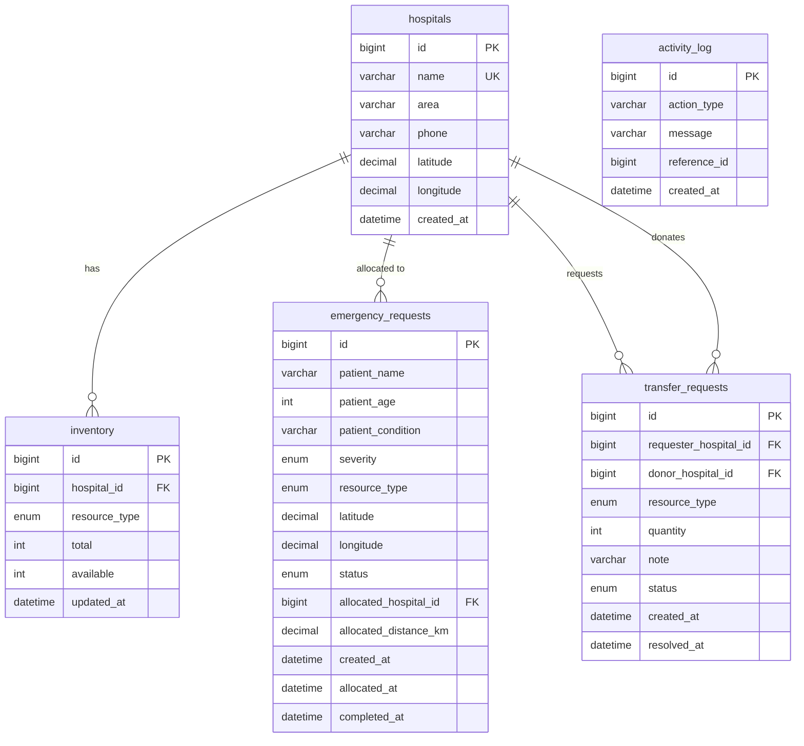

# MediSync Live

**Real-Time Hospital Resource Sharing and Emergency Bed Allocation System**

MediSync Live gives a group of hospitals one live view of their beds and critical equipment. It
allocates the nearest suitable bed to an emergency patient automatically. When no bed is free, the
patient waits in a severity-based priority queue and is served as soon as capacity appears. Hospitals
can also lend capacity to each other with donor approval.

This is a Java Spring Boot reimplementation of the project report *MediSync Live*
(21CSE354T Full Stack Web Development, SRM IST). The original used Node.js, Express and Socket.IO;
this one uses Spring Boot 3, Spring WebSocket/STOMP, MySQL 8 and React + TypeScript.

> ⚠️ **Academic prototype.** All patient data is synthetic. Hospital capacities are demo values
> taken from the report, not live hospital inventory. The app is not clinically validated and has
> no login or role enforcement, so it must not be used for real emergency dispatch.

---

## Features

| Area | What it does |
|---|---|
| **Live dashboard** | Summary cards: available/total, active admissions, waiting patients, average distance. One card per hospital with 5 colour-coded bars (green ≥ 40 % free, amber 15–40 %, red < 15 %), filters (hospital / resource / availability level), a capacity chart and a live activity feed. |
| **Emergency allocation** | Validated request form (area picker, *Use my location*, or manual coordinates). The nearest hospital with a free unit of the required type is found by Haversine distance, and one unit is reserved inside a locked transaction. |
| **Priority queue** | Requests with no free bed are stored `PENDING` and served CRITICAL → SERIOUS → STABLE, first-come-first-served within a severity. Dispatch runs after discharge, cancellation, capacity increase and transfer approval. |
| **Discharge / cancel** | Discharge or cancel releases the unit exactly once and serves the queue. Cancelling a pending request changes no counts. Invalid transitions return 409. |
| **Resource sharing** | Hospital A requests N units from hospital B. The donor approves (one atomic transaction moves both total and available) or rejects (status only). Same-hospital, non-integer, ≤ 0, insufficient-stock and duplicate decisions are rejected. |
| **Hospital admin** | Edit total/available per resource row. Available ≤ total is enforced, and occupied units can never drop below the patients currently allocated there. |
| **Real time** | STOMP over WebSocket at `/ws`. Events are broadcast to `/topic/updates` **only after the transaction commits**. The UI shows Live / Reconnecting / Offline, auto-reconnects and reloads all data after reconnecting. |
| **Audit** | Every request, allocation, queueing, release, edit and transfer decision is written to `activity_log` in the same transaction. |

## Technology stack

| Layer | Technology |
|---|---|
| Backend | Java 21, Spring Boot 3.3.4 (Web, Data JPA/Hibernate 6, Validation, WebSocket/STOMP, Actuator), Lombok, Flyway, springdoc-openapi |
| Database | MySQL 8 (tested on MySQL 9.0), InnoDB, READ COMMITTED |
| Frontend | React 18 + Vite 5 + TypeScript, Tailwind CSS 4, shadcn/ui-style components (Radix), lucide-react, React Router, Axios, TanStack Query 5, Recharts, @stomp/stompjs, React Hook Form + Zod, sonner toasts |
| Tests | JUnit 5, Mockito, Spring MockMvc, MySQL-backed integration tests (Testcontainers when Docker is present), Vitest + Testing Library |

## Architecture

```mermaid
flowchart LR
    subgraph Browser["React SPA (localhost:5173)"]
        UI[Pages: Dashboard / Emergency / Sharing / Admin]
        RQ[TanStack Query cache]
        WS[STOMP client]
        UI --> RQ
        WS -- invalidate --> RQ
    end
    subgraph Spring["Spring Boot (localhost:8080)"]
        C[REST controllers<br/>@RestControllerAdvice]
        R[TransactionRetryExecutor]
        S[Services<br/>Emergency / Inventory / Transfer / Hospital]
        E[AllocationEngine<br/>Haversine + priority queue]
        A[ActivityService]
        P[ChangePublisher]
        N[RealtimeNotifier<br/>@TransactionalEventListener AFTER_COMMIT]
        B[(Simple STOMP broker<br/>/topic/updates)]
        C --> R --> S --> E
        S --> A
        S --> P -. after commit .-> N --> B
    end
    DB[(MySQL 8<br/>Flyway migrations)]
    RQ -- "HTTP /api (Vite proxy)" --> C
    WS <-- "ws /ws (Vite proxy)" --> B
    S -- "JPA, SELECT ... FOR UPDATE" --> DB
```

Layering: **Controller → (retry) → @Transactional Service → Repository → MySQL**. Controllers only
exchange DTOs (Java records); JPA entities are never serialised.

### Backend layout

```
backend/src/main/java/com/medisync/live/
  MediSyncApplication.java
  config/      WebConfig (CORS, OpenAPI), WebSocketConfig (STOMP /ws, /topic)
  controller/  HospitalController, InventoryController, EmergencyController, TransferController
  dto/         request/response records, ErrorResponse
  entity/      Hospital, Inventory, EmergencyRequest, TransferRequest, ActivityLog
  enums/       ResourceType, Severity, RequestStatus, TransferStatus, ActivityType
  exception/   NotFound / BadRequest / Conflict + GlobalExceptionHandler
  repository/  Spring Data JPA repositories (pessimistic-lock queries)
  service/     AllocationEngine, EmergencyService, InventoryService, TransferService,
               HospitalService, ActivityService, GeoUtils, DtoMapper, TransactionRetryExecutor
  websocket/   DataChangedEvent, ChangePublisher, RealtimeNotifier, UpdateMessage
backend/src/main/resources/
  application.yml
  db/migration/V1__create_schema.sql, V2__seed_sample_data.sql
```

### Frontend layout

```
frontend/src/
  App.tsx, main.tsx, index.css
  components/        Layout, ActivityFeed, AvailabilityBar, common (badges, empty/error states, confirm dialog)
  components/ui/     shadcn-style button, card, form controls, badge, progress, table, skeleton, alert-dialog
  components/emergency/  EmergencyForm, AllocationResultCard, RequestsTable, PriorityQueue
  components/sharing/    TransferForm
  contexts/RealtimeContext.tsx   STOMP connection, status, query invalidation
  hooks/queries.ts               TanStack Query hooks and mutations
  services/api.ts                Axios client + ApiError
  types/api.ts                   TypeScript mirrors of backend DTOs
  lib/                           format helpers, thresholds, sample areas
  pages/                         DashboardPage, EmergencyPage, ResourceSharingPage, HospitalAdminPage
  test/                          Vitest suites
```

## Concurrency design (no double booking)

Every operation that can change availability of a resource type (create request, discharge, cancel,
admin edit, transfer approval) runs in **one transaction** and first runs

```sql
SELECT ... FROM inventory WHERE resource_type = ? ORDER BY id FOR UPDATE   -- JPA PESSIMISTIC_WRITE
```

Then it locks emergency requests (pending queue or the target request). This gives one
**deterministic lock order**: transfer row → inventory rows by id → request rows. Competing writers
for the same type are serialised, and lock-order deadlocks cannot happen. While those locks are
held, `Inventory.tryReserveOne()` is a guarded decrement (`available > 0`). The MySQL `CHECK
(available >= 0 AND available <= total)` constraint is the last line of defence.

* Pre-lock reads are scalar (`select r.resourceType ...`). Loading an entity before locking would
  leave a stale snapshot that Hibernate does not refresh.
* A new request is inserted as `PENDING` and then the type's queue is dispatched. A newcomer
  therefore never overtakes a more urgent patient who is already waiting.
* The isolation level is READ COMMITTED (no gap locks). Deadlocks and lock timeouts that still occur
  are retried up to 4 times by `TransactionRetryExecutor`, each attempt in a fresh transaction.
* WebSocket events are `ApplicationEvent`s delivered by
  `@TransactionalEventListener(phase = AFTER_COMMIT)`, so a rolled-back operation never notifies anyone.
* All server-generated timestamps are UTC. The JDBC session is forced to UTC so MySQL `CURRENT_TIMESTAMP`
  defaults agree with application timestamps.

## Database schema

Five tables (report Table 2.3), created by Flyway (`V1__create_schema.sql`). Hibernate is set to
`ddl-auto: none`.



Constraints: `UNIQUE(hospital_id, resource_type)`, `CHECK(total >= 0)`,
`CHECK(available >= 0 AND available <= total)`, `CHECK(quantity > 0)`,
`CHECK(requester <> donor)`, and a status/hospital consistency check on requests. There are indexes
for the queue scan, per-hospital allocation counts, transfer status and the activity timeline.

### Sample data (`V2__seed_sample_data.sql`)

Six Chennai hospitals × five resource types = 30 inventory rows, **444 available of 1460**. Names,
areas, phones and every count come from the report's dashboard screenshot (Fig. 3.3, with its single
approved ventilator transfer reversed) and Fig. 3.1. The coordinates are approximate demo values,
chosen so that the report's Table 3.2 allocations come out the same:

| Patient area | Bed type | Allocated hospital | Distance |
|---|---|---|---|
| T. Nagar | ICU | Kauvery Hospital | 2.3 km |
| Anna Nagar | VENTILATOR | Apollo Hospitals | 5.1 km |
| Tambaram | GENERAL | Sri Ramachandra Medical Centre | 13.4 km |
| Perambur | EMERGENCY | Government General Hospital | 6.2 km |
| Porur | OXYGEN | Sri Ramachandra Medical Centre | 1.3 km |

The seed is idempotent (`ON DUPLICATE KEY` / `NOT EXISTS`) and Flyway applies it once. The patient
area list is configurable in `frontend/src/lib/areas.ts`.

---

## Requirements

| Tool | Version |
|---|---|
| JDK | 21 or newer (the build targets `--release 21`; verified with JDK 22) |
| Maven | 3.9+ |
| Node.js | 20+ (verified with 22) and npm 10+ |
| MySQL | 8.0+ (verified with MySQL 9.0 on Windows) |
| Docker | optional |

## Installation and configuration

### 1. Database

**Option A: Docker (optional)**

```powershell
copy .env.example .env      # adjust passwords if you like
docker compose up -d
```

**Option B: Manual MySQL setup (no Docker)**

```powershell
mysql -u root -p < database\setup-mysql.sql
```

The script creates the databases `medisync_live` and `medisync_test` and the user
`medisync` / `medisync`. Tables and seed data are created by Flyway when the backend starts.

Configuration uses environment variables (defaults in `backend/src/main/resources/application.yml`):

| Variable | Default |
|---|---|
| `DB_URL` | `jdbc:mysql://localhost:3306/medisync_live?...&connectionTimeZone=UTC&forceConnectionTimeZoneToSession=true` |
| `DB_USERNAME` / `DB_PASSWORD` | `medisync` / `medisync` |
| `SERVER_PORT` | `8080` |
| `CORS_ALLOWED_ORIGINS` | `http://localhost:5173,http://127.0.0.1:5173` |

### 2. Run the backend (http://localhost:8080)

```powershell
cd backend
mvn spring-boot:run
# or: mvn package -DskipTests ; java -jar target\medisync-live-backend-1.0.0.jar
```

PowerShell with custom credentials: `$env:DB_USERNAME="me"; $env:DB_PASSWORD="secret"; mvn spring-boot:run`

* Health: http://localhost:8080/actuator/health
* Swagger UI: http://localhost:8080/swagger-ui.html

### 3. Run the frontend (http://localhost:5173)

```powershell
cd frontend
npm install
npm run dev
```

The Vite dev server proxies `/api` and `/ws` (WebSocket) to `localhost:8080`, so no CORS setup is
needed in development. Point it at another backend with `VITE_BACKEND_URL`.

### 4. Tests

```powershell
cd backend
mvn test                                    # 58 tests: unit + MySQL integration
mvn test -DexcludedTestGroups=integration   # unit tests only, no database needed

cd ..\frontend
npm test                                    # Vitest
```

Integration tests choose a database in this order:
1. `TEST_DB_URL` (+ `TEST_DB_USERNAME`/`TEST_DB_PASSWORD`) if set.
2. Otherwise a MySQL 8 **Testcontainer** if Docker is available.
3. Otherwise local `localhost:3306/medisync_test` with `DB_USERNAME`/`DB_PASSWORD` (default `medisync`).

Each test rebuilds the schema with Flyway (clean + migrate). **Never point the tests at
`medisync_live`**, because the clean step would wipe it.

### 5. Build

```powershell
cd backend ; mvn package          # backend\target\medisync-live-backend-1.0.0.jar
cd ..\frontend ; npm run build    # type-check + frontend\dist\
```

---

## REST API

All responses are JSON. Errors share one shape:
`{ timestamp, status, error, message, path, fieldErrors? }`. Status codes: 400 invalid input, 404
missing record, 409 business-rule or state conflict, 500 unexpected.

| Method | Path | Purpose |
|---|---|---|
| GET | `/api/hospitals` | Hospitals with all inventory rows |
| GET | `/api/hospitals/{id}` | One hospital |
| GET | `/api/stats` | Capacity, available, active admissions, waiting, avg distance, per-resource totals |
| GET | `/api/activity?limit=30` | Latest activity entries (max 200) |
| GET | `/api/inventory` | All 30 inventory rows (with active allocation counts) |
| GET | `/api/inventory/hospital/{hospitalId}` | Inventory of one hospital |
| PATCH | `/api/inventory/{id}` | `{ total, available }` - validated update; extra capacity serves the queue |
| GET | `/api/requests?status=&severity=&resourceType=&search=` | Requests, newest first |
| GET | `/api/requests/{id}` | One request |
| GET | `/api/requests/queue` | Pending requests in dispatch order, with per-type `queuePosition` |
| POST | `/api/requests` | Create + allocate or queue → `201 { allocated, message, request }` |
| POST | `/api/requests/{id}/discharge` | ALLOCATED → DISCHARGED, release unit, serve queue |
| POST | `/api/requests/{id}/cancel` | PENDING/ALLOCATED → CANCELLED (releases if allocated) |
| GET | `/api/transfers` | Transfer requests, newest first |
| POST | `/api/transfers` | `{ requesterHospitalId, donorHospitalId, resourceType, quantity, note? }` → PENDING |
| POST | `/api/transfers/{id}/approve` | Atomic capacity move + queue dispatch |
| POST | `/api/transfers/{id}/reject` | Status only |

## WebSocket communication

* Endpoint: `ws://localhost:8080/ws` (native WebSocket, STOMP 1.2; heart-beats every 10 s)
* Topic: `/topic/updates`
* Payload: `{ "type": "ALLOCATED", "entity": "REQUEST", "referenceId": 12, "timestamp": "..." }`
* Types: `REQUEST_CREATED, ALLOCATED, QUEUED, DISCHARGED, CANCELLED, INVENTORY_UPDATED,
  TRANSFER_REQUESTED, TRANSFER_APPROVED, TRANSFER_REJECTED`

The client invalidates the matching TanStack Query keys, so every open window refreshes without a
reload. After a reconnect it reloads everything.

## Demonstration walkthrough

Open **two browser windows** on http://localhost:5173 side by side.

1. **Dashboard:** the cards read *444 / 1460*, 0 active, 0 waiting. Kauvery ICU (1/18) is red,
   Apollo ICU (5/30) amber, Apollo Emergency (8/20) green.
2. **Emergency allocation (TC 2.1):** in window 1 go to *Emergency* and enter a fictional patient,
   *Critical*, *ICU bed*, area *T. Nagar*, then click *Find nearest bed*. Result: **Kauvery Hospital,
   ~2.3 km**. Window 2's dashboard shows Kauvery ICU at 0/18 without a reload.
3. **Queue (TC 2.2 / 2.4):** submit a *Stable* ICU patient and then a *Critical* ICU patient, both
   from T. Nagar, after using *Hospital Admin* to set all ICU *available* counts to 0. Both wait;
   the queue panel shows the Critical patient first.
4. **Automatic dispatch:** discharge the first patient (or add 1 available ICU unit in *Hospital
   Admin*). The **Critical** patient is allocated at once and the Stable one stays queued.
5. **Cancel (TC 2.5):** cancelling a pending request changes no counts. Cancelling an allocated one
   frees its bed.
6. **Transfer (TC 3.1–3.4):** under *Resource Sharing*, MIOT International asks Apollo Hospitals for
   2 ICU beds. Approve it, and Apollo ICU total/available drop by 2 while MIOT's rise by 2. A
   request for 7 ventilators from Government General (5 free) fails with *"Donor does not have
   enough available units"* and stays PENDING. Reject it, and only the status changes.
7. **Validation (TC 1.3 / 2.7 / 3.5 / 3.6):** try available > total, an empty patient name, the
   same requester and donor, or quantity 0 / -1 / 2.5. Each gets a clear message and nothing changes.
8. **Offline indicator:** stop the backend. The header switches to *Reconnecting*. Start it again;
   it returns to *Live* and reloads the data.

### Example: emergency allocation

```http
POST /api/requests
{ "patientName": "Test Patient Ravi", "patientAge": 58, "patientCondition": "Synthetic cardiac case",
  "severity": "CRITICAL", "resourceType": "ICU", "latitude": 13.0418, "longitude": 80.2341 }

201 { "allocated": true, "message": "ICU bed reserved at Kauvery Hospital (2.3 km away).",
      "request": { "id": 1, "status": "ALLOCATED", "hospitalName": "Kauvery Hospital", "distanceKm": 2.29, ... } }
```

With no free ICU bed: `allocated: false`, `message: "Currently no suitable bed is available. The
request has been added to the priority queue."`, `status: "PENDING"`, `queuePosition: 1`.

### Example: inter-hospital transfer

Hospital B has 10 ICU in total and 4 free; Hospital A asks for 2.

```http
POST /api/transfers            { "requesterHospitalId": A, "donorHospitalId": B, "resourceType": "ICU", "quantity": 2 }
POST /api/transfers/{id}/approve
```

After approval B shows 8 total / 2 available, and A shows +2 total / +2 available, in one
transaction. Any waiting ICU patients are then allocated from the new capacity. This is verified by
`TransferIT.reportTransferExample`.

## Acceptance checklist (report test cases)

| TC | Scenario | Automated test |
|---|---|---|
| 1.1 | Load dashboard | `DashboardAndInventoryIT.dashboardListsAllHospitalsAndResources` |
| 1.2 | Update capacity | `…inventoryUpdatePersistsAndIsLogged` |
| 1.3 | Invalid capacity | `…availableAboveTotalRejected`, `…invalidCountsRejected` |
| 1.4 | Real-time sync | `RealtimeAndRollbackIT.stompClientReceivesUpdate` |
| 1.5 | Activity feed | `…inventoryUpdatePersistsAndIsLogged` |
| 1.6 | Summary cards | `…statsMatchDatabaseTotals` |
| 2.1 | Allocation with free beds | `EmergencyAllocationIT.nearestHospitalSelectedAndCountReduced`, `table32Allocations` |
| 2.2 | No bed available | `…noBedGivesPending` |
| 2.3 | Discharge | `…dischargeReleasesBed` |
| 2.4 | Priority order | `…criticalServedFirst`, `…reportQueueExampleOrder`, `…equalSeverityFifo` |
| 2.5 | Cancel pending | `…cancelPendingKeepsInventory` |
| 2.6 | Last bed (concurrent) | `ConcurrencyIT.twoRequestsForLastBed`, `…manyRequestsLimitedCapacity` |
| 2.7 | Missing name | `…invalidInputRejected`, `ControllerValidationTest` |
| 3.1 | Create transfer | `TransferIT.createTransfer` |
| 3.2 | Approve | `…approveMovesCapacity`, `…reportTransferExample` |
| 3.3 | Insufficient stock | `…insufficientStockBlocksApproval` |
| 3.4 | Reject | `…rejectKeepsInventory` |
| 3.5 | Same hospital | `…validationRules` |
| 3.6 | Invalid quantity | `…validationRules`, frontend `forms.test.tsx` |
| - | No event on rollback; failed tx leaves counts intact | `RealtimeAndRollbackIT.*` |
| - | Duplicate discharge / approval races | `ConcurrencyIT.concurrentDischargeOnlyOnce`, `…concurrentApprovalOnlyOnce` |

## Troubleshooting

| Symptom | Fix |
|---|---|
| `Access denied for user 'medisync'` | Run `database/setup-mysql.sql` as root, or set `DB_USERNAME`/`DB_PASSWORD`. |
| Header stays *Reconnecting* | The backend is not on 8080, or you opened the built `dist/` without a proxy. Use `npm run dev`, or set `VITE_WS_URL=ws://localhost:8080/ws` and `VITE_API_BASE_URL=http://localhost:8080`. |
| `Port 5173 is in use` | Stop the other Vite process (the port is fixed so the CORS origin matches). |
| Flyway warns "MySQL 9.0 is newer than this version" | Harmless; the schema uses only MySQL 8 features. |
| Flyway checksum mismatch after editing a migration | Never edit applied migrations; add `V3__...sql`. For a demo reset run `DROP DATABASE medisync_live;` and restart. |
| Integration tests fail to connect | Create `medisync_test` (setup script) or set `TEST_DB_URL`. |
| Activity times look shifted | Keep `connectionTimeZone=UTC&forceConnectionTimeZoneToSession=true` in `DB_URL`. |
| "Use my location" fails | The browser needs location permission, and geolocation requires `localhost` or HTTPS. Use an area or manual coordinates instead. |

## Limitations

* Straight-line (great-circle) distance, not road distance or travel time.
* No authentication or role-based access. The access matrices in the report are intended levels only.
* Single backend instance: the in-memory STOMP broker does not span multiple servers (a relay
  broker would be needed to scale out).
* Seed coordinates are approximate, and all patient data is fictional.
